# InfraBIDS — Enterprise Software & Geodata Ecosysteem

  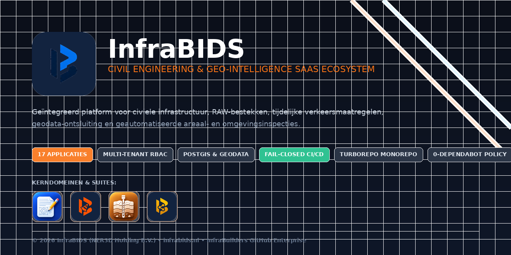

  
  
  
  
  

---

## 🏗️ Over InfraBIDS

**InfraBIDS** (onderdeel van NER3D Holding B.V.) ontwikkelt en exploiteert een geïntegreerd SaaS- en data-ecosysteem voor de civiele techniek, grond-, weg- en waterbouw (GWW), geo-informatie en verkeersmanagement in Nederland en Europa.

Ons ecosysteem brengt de gehele levenscyclus van civiele projecten samen in een samenhangende suite: van initiële veldmetingen, sonderingen en LiDAR-pointclouds tot geautomatiseerde RAW-bestekken, 2D/3D verkeersmaatregelen (TVM), machine learning objectinspecties en areaalbeheer.

---

## 🏛️ De Vier Suites & 17 Applicaties

<table>
  <thead>
    <tr>
      <th width="80">Icoon</th>
      <th width="220">Applicatie</th>
      <th>Domein & Functionaliteit</th>
      <th width="140">Status & Stack</th>
    </tr>
  </thead>
  <tbody>
    <!-- Domein 1: Geo-Data, Veldwerk & Scanning -->
    <tr>
      <td colspan="4" bgcolor="#1e293b"><strong>🌐 1. Geo-Data, Veldinspectie & Digital Twins</strong></td>
    </tr>
    <tr>
      <td>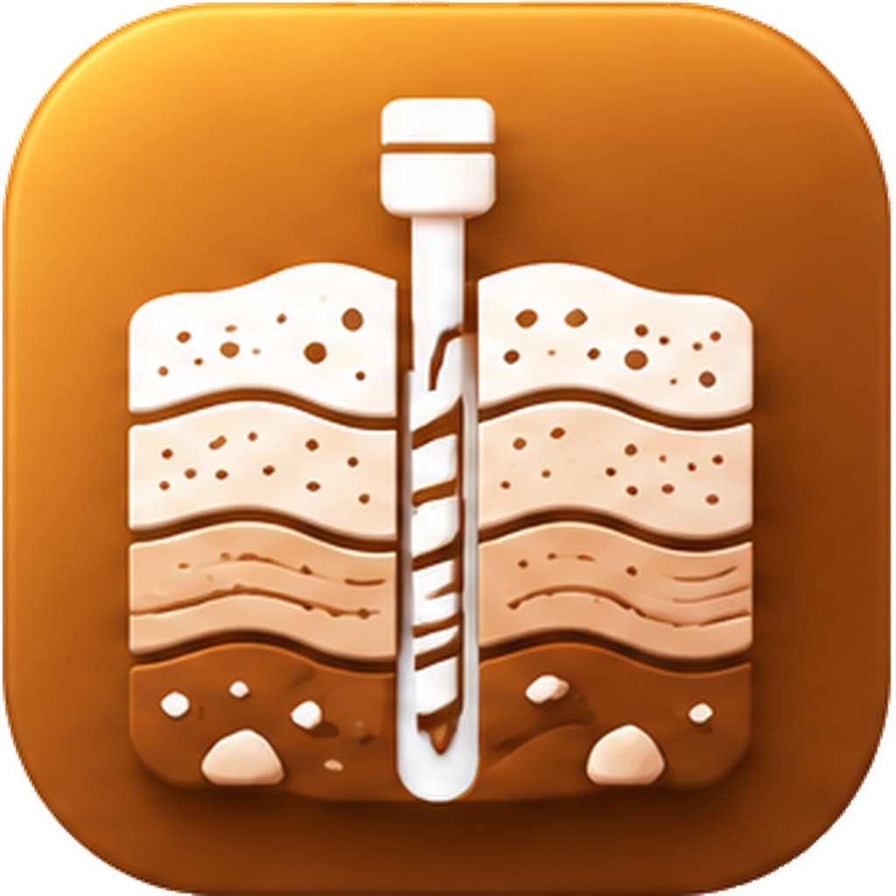</td>
      <td><strong>Bodemonderzoeker</strong></td>
      <td>Geotechnisch en milieuhygiënisch bodemonderzoek, sonderingen, boorprofielen en geochemische bodemkwaliteitskaarten.</td>
      <td><code>Productie</code> React • GIS</td>
    </tr>
    <tr>
      <td>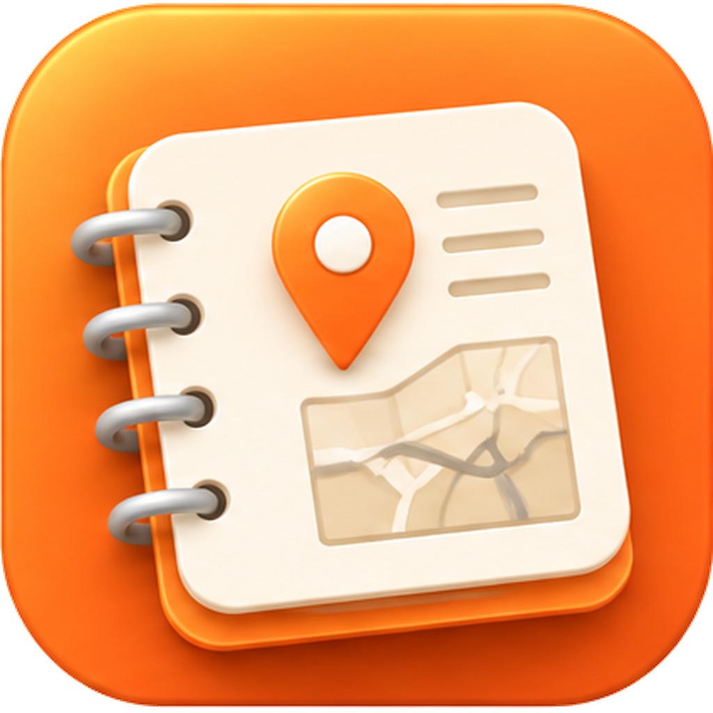</td>
      <td><strong>Veldboek</strong></td>
      <td>Digitale inspectie- en meetstaatregistratie op locatie met offline ondersteuning, revisiemetingen en GPS-koppeling.</td>
      <td><code>Productie</code> PWA • SQLite</td>
    </tr>
    <tr>
      <td>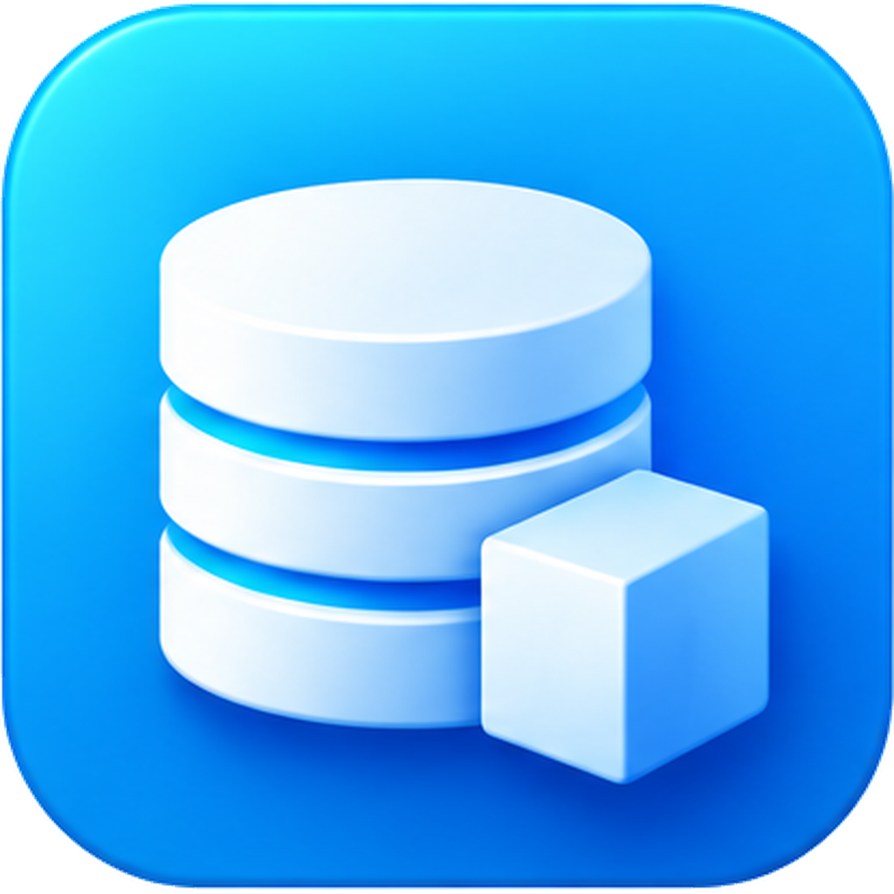</td>
      <td><strong>Datavisualisator</strong></td>
      <td>Civiele en ruimtelijke datasets converteren naar hoogwaardige interactieve kaartlagen en analysetools.</td>
      <td><code>Productie</code> MapLibre • PostGIS</td>
    </tr>
    <tr>
      <td>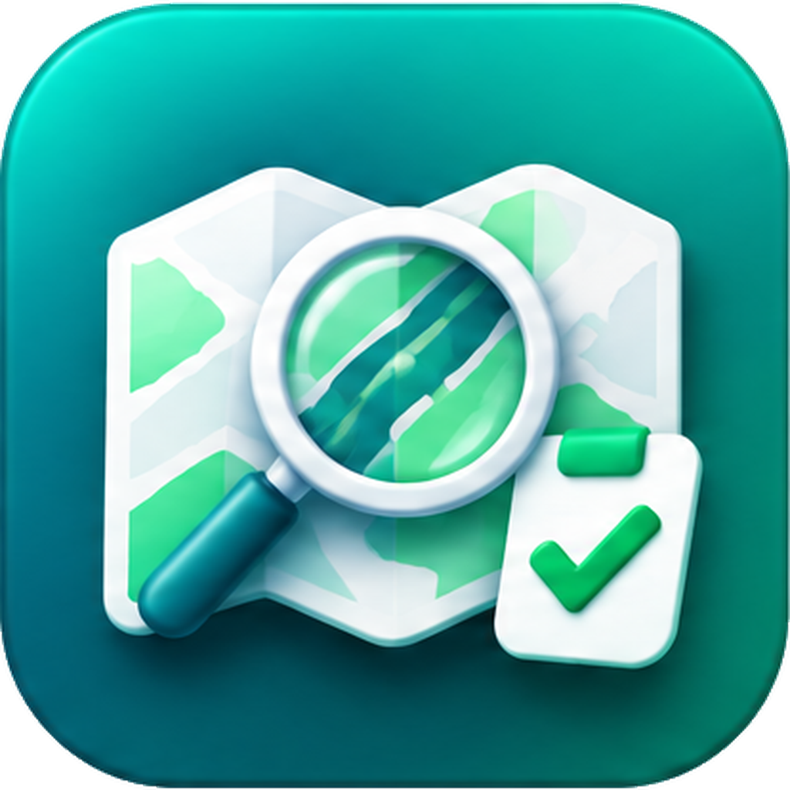</td>
      <td><strong>Areaal-Inspector</strong></td>
      <td>Computer vision en AI voor geautomatiseerde assetdetectie, wegmarkeringen, scheurvorming en borden.</td>
      <td><code>Productie</code> OpenCV • Python</td>
    </tr>
    <tr>
      <td></td>
      <td><strong>Infrafoto</strong></td>
      <td>Gegeorefereerde 360-graden panoramabeelden en orthofotomozaïeken met millimeter-nauwkeurige meetfuncties.</td>
      <td><code>Productie</code> Three.js • WebGL</td>
    </tr>
    <!-- Domein 2: Ontwerp, Calculatie & Bestekken -->
    <tr>
      <td colspan="4" bgcolor="#1e293b"><strong>📐 2. Ontwerp, Calculatie & RAW-Bestekken</strong></td>
    </tr>
    <tr>
      <td>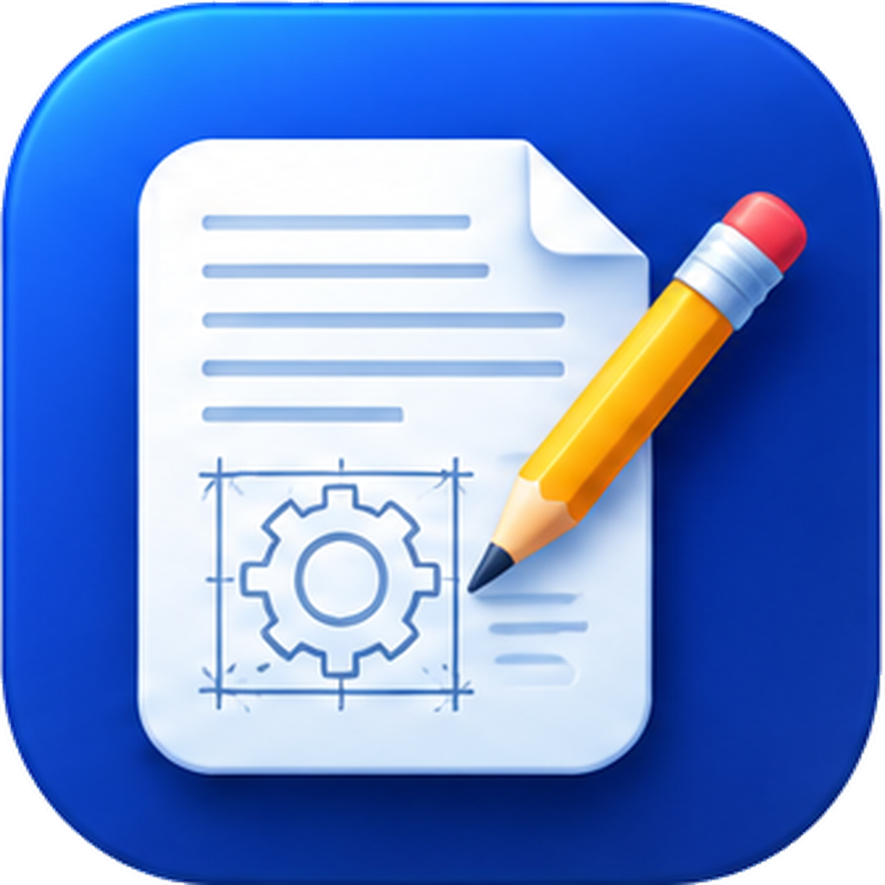</td>
      <td><strong>BestekStudio</strong></td>
      <td>Van CAD/GIS-ontwerp en objectkaarten rechtstreeks naar RAW-bestekken, inschrijfstaten en CROW-hoofdstukken.</td>
      <td><code>Productie</code> FastAPI • CROW</td>
    </tr>
    <tr>
      <td>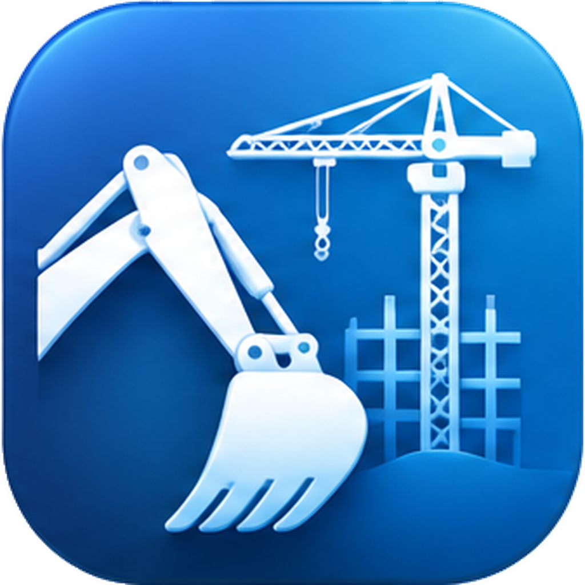</td>
      <td><strong>GWWStudio</strong></td>
      <td>Integrale GWW-calculatie, SSK-kostenramingen, risicomodellering en UAV-GC projectbeheersing.</td>
      <td><code>Productie</code> React • Calc Engine</td>
    </tr>
    <tr>
      <td>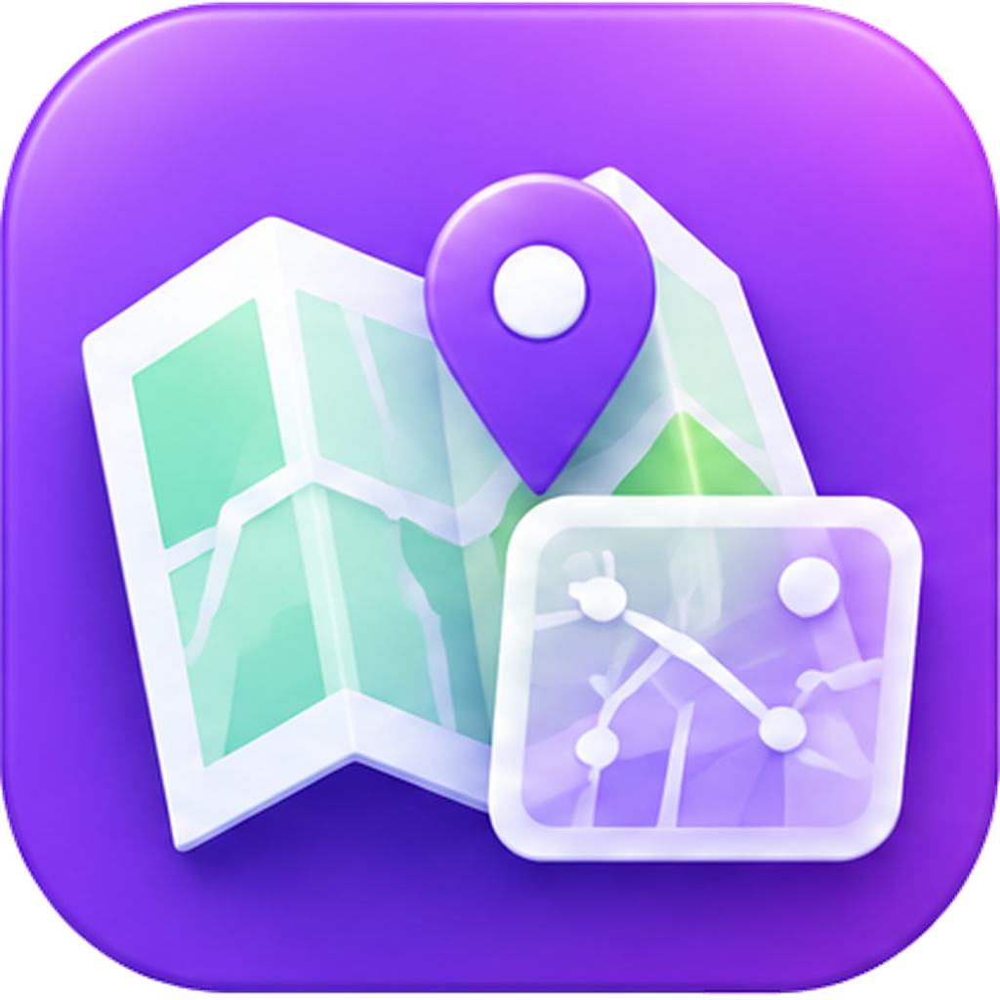</td>
      <td><strong>Gebiedsportaal</strong></td>
      <td>Centraal portaal voor project- en gebiedsontwikkeling waarin plannen, omgevingsfactoren en ontwerpen samenkomen.</td>
      <td><code>Productie</code> Next.js • Spatial API</td>
    </tr>
    <!-- Domein 3: Verkeersmanagement, Leggers & Omgeving -->
    <tr>
      <td colspan="4" bgcolor="#1e293b"><strong>🚦 3. Verkeersmanagement, Leggers & Omgeving</strong></td>
    </tr>
    <tr>
      <td></td>
      <td><strong>TVM-Platform</strong></td>
      <td>End-to-end multi-tenant workflow SaaS voor tijdelijke verkeersmaatregelen, vergunningen, faseringen en wegbeheerders.</td>
      <td><code>Productie</code> Express • Postgres • Vite</td>
    </tr>
    <tr>
      <td></td>
      <td><strong>TVMStudio</strong></td>
      <td>Gespecialiseerde 2D/3D ontwerptool voor het intekenen van bebording, afzettingen en omleidingsroutes conform CROW 96a/96b.</td>
      <td><code>Productie</code> Canvas • SVG • GIS</td>
    </tr>
    <tr>
      <td>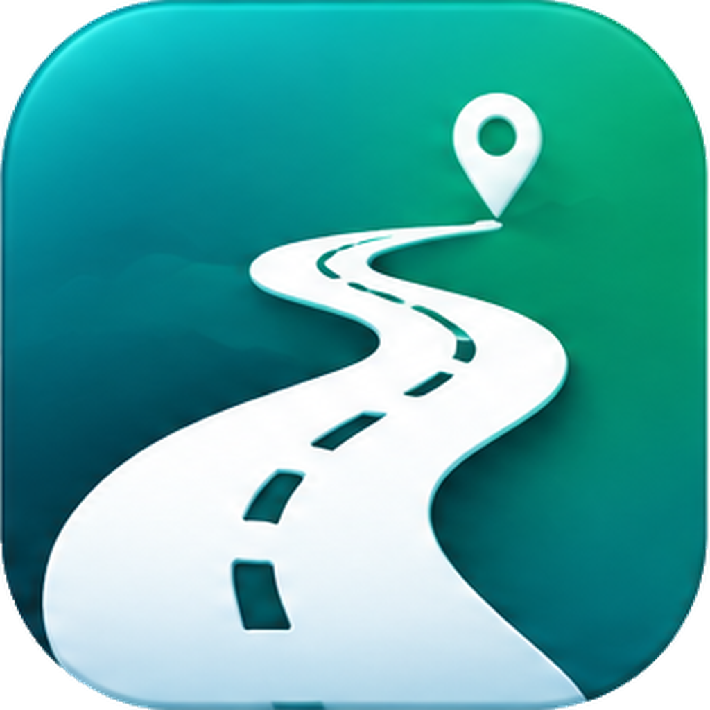</td>
      <td><strong>Legger-Blick (Wegenlegger)</strong></td>
      <td>Juridische en feitelijke wegenlegger, schouwbeheer, openbare bestemmingen en onderhoudsplichten.</td>
      <td><code>Productie</code> React • Geo-database</td>
    </tr>
    <tr>
      <td>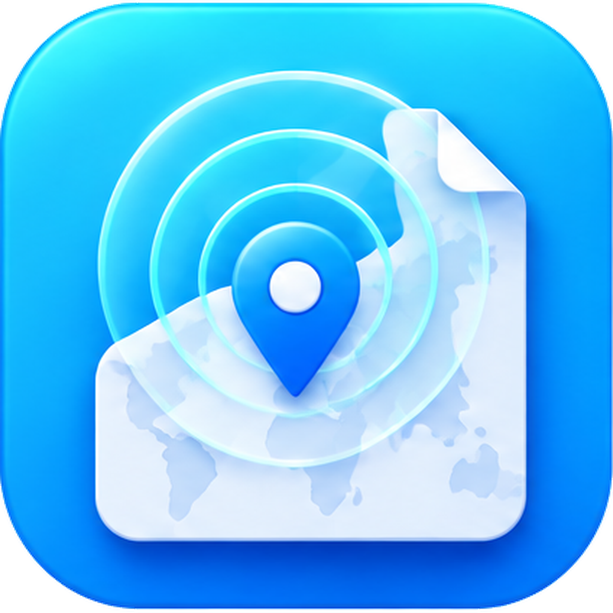</td>
      <td><strong>Omgevingsscanner</strong></td>
      <td>BLVC-dossiers (Bereikbaarheid, Leefbaarheid, Veiligheid, Communicatie), stakeholder-analyses en vergunningchecks.</td>
      <td><code>Productie</code> FastAPI • Kadaster</td>
    </tr>
    <!-- Domein 4: Core Frameworks & Shell -->
    <tr>
      <td colspan="4" bgcolor="#1e293b"><strong>⚙️ 4. Core Platform & Frameworks</strong></td>
    </tr>
    <tr>
      <td>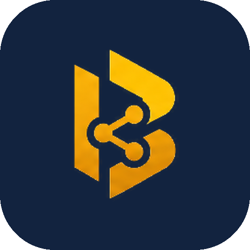</td>
      <td><strong>InfraBIDShare</strong></td>
      <td>Centrale datakern, cross-app autorisaties, data-product catalogus en universele integratie-API's.</td>
      <td><code>Core Platform</code> Node • REST / gRPC</td>
    </tr>
    <tr>
      <td>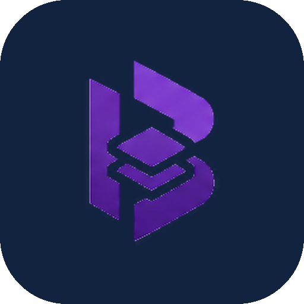</td>
      <td><strong>InfraBIDSuite</strong></td>
      <td>Enterprise app-shell met context-switching, multi-tenant tenancy en Single Sign-On (SSO).</td>
      <td><code>Enterprise Shell</code> React • OIDC</td>
    </tr>
    <tr>
      <td>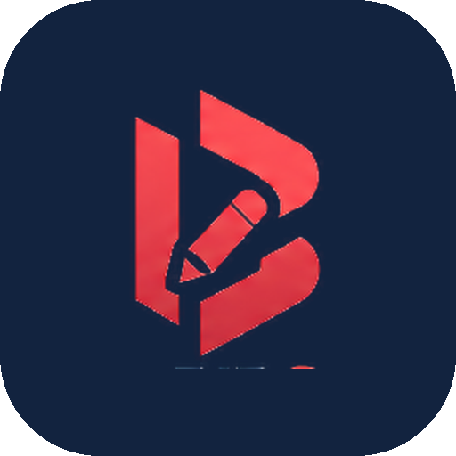</td>
      <td><strong>Infra Design Studio</strong></td>
      <td>Het gecentraliseerde design system met officiële merk-tokens, componenten en iconografie voor alle suites.</td>
      <td><code>Design System</code> Tailwind • shadcn</td>
    </tr>
    <tr>
      <td>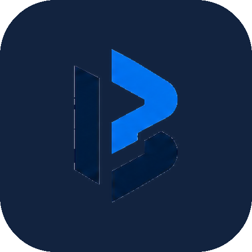</td>
      <td><strong>InfraBIDS Homepage</strong></td>
      <td>De officiële propositie-website en publieke showcase van het complete ecosysteem.</td>
      <td><code>Publiek</code> TanStack Start • SSR</td>
    </tr>
  </tbody>
</table>

---

## 🔒 Beveiliging, Governance & CI/CD Kwaliteitseisen

Binnen de repositories van **InfraBuilders** hanteren we strikte kwaliteits- en beveiligingsstandaarden:

- **Fail-Closed Deployment Gates**: Geen enkele release kan worden uitgerold zonder succesvolle preflight-validatie, build en readiness-smoketests.
- **Zero-Trust Security**: Strikte multi-tenant isolatie op database-, API- en applicatieniveau. Geen gedeelde sessies over tenants heen.
- **Branch Protection & Automated Quality**: De  branches worden continu beschermd met verplichte status checks, linting, typechecking en hermetische build-tests.
- **Vulnerability Management**: Actieve monitoring met 0 toegestane openstaande Dependabot kwetsbaarheden op productielijnen.

---

## 📬 Contact & Bedrijfsinformatie

* **Organisatie**: InfraBIDS (NER3D Holding B.V.)  
* **Website**: [https://infrabids.nl](https://infrabids.nl)  
* **Hoofdkantoor**: Nederland  
* **Centrale Ecosysteem Repository**: 
